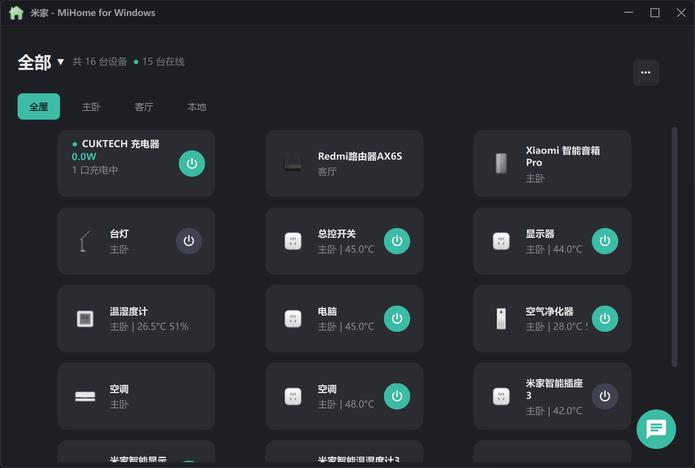
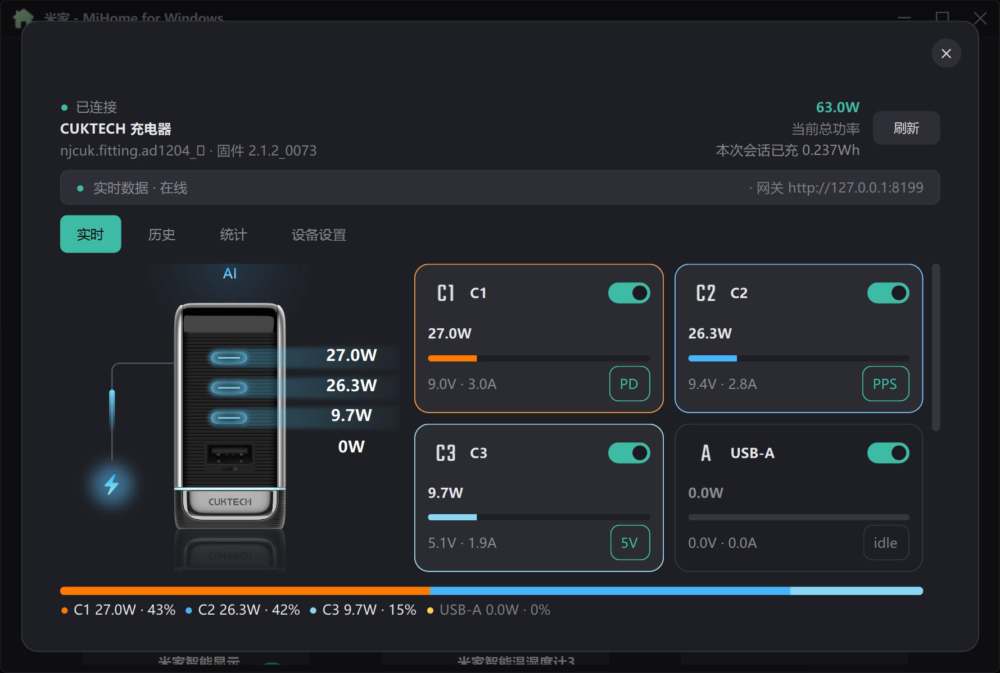

<div align="center">

# MiHome-Ex

**米家设备的 Windows 桌面控制端（扩展版）**

基于 [mijiaAPI](https://github.com/Do1e/mijia-api) 构建图形界面，扫码登录后即可在本地窗口中查看和控制家里的全部米家设备。
由 [huanyuejue/MiHome-Windows](https://github.com/huanyuejue/MiHome-Windows) fork 改造而来，并集成了 [kairui1108/cuktech-ble-server](https://github.com/kairui1108/cuktech-ble-server)（[本 fork 维护版](https://github.com/Arimayuki03/cuktech-ble-server)） 作为本地 BLE 数据源。

[](https://github.com/Arimayuki03/MiHome-Ex/releases/latest)
[](https://github.com/Arimayuki03/MiHome-Ex/actions/workflows/ci.yml)
[](LICENSE)
[](https://github.com/Arimayuki03/MiHome-Ex)
[](https://www.python.org/)
[](https://www.qt.io/)
[](https://github.com/Arimayuki03/MiHome-Ex/issues)
[](https://github.com/Arimayuki03/MiHome-Ex/stargazers)

**[下载最新版](https://github.com/Arimayuki03/MiHome-Ex/releases/latest) · [功能一览](#-功能) · [快速开始](#-快速开始) · [构建](#-构建可执行文件) · [参与贡献](#-参与贡献)**



</div>

---

> [!IMPORTANT]
> 当前项目仍处于早期版本。作者个人米家设备有限，无法对各类设备做针对性适配测试，UI 和操作逻辑的完善度不算很高。基础使用（扫码登录、设备列表与常用控制、托盘、小爱语音等）已无大碍，适配更多设备功能则需要社区支持。
>
> 本程序与小米官方无关，不含任何担保，请自行承担使用风险，并遵守小米的服务条款。

## 🆕 0.7.0 更新亮点

- 吸收上游 MiHome-Windows `0.3.0 → 0.5.0`：桌面挂件、定时开关、控件主题色、房间/卡片排序、托盘双击与自定义图标配色等
- 内置 CUKTECH BLE 服务端升级到 fork 维护版 **v2.1.0**（吸收上游 v2.0.1：多设备架构、年度热力图、HA 静默期计量）
- 保留 fork 修复：端口/协议写确认与读回自愈、Windows 干净退出自重启、MQTT retained 状态补发、前端乐观回滚与竞态守卫
- 完整变更见 [RELEASE_NOTES_0.7.0.md](RELEASE_NOTES_0.7.0.md)

## ✨ 功能

### 米家设备控制（继承自上游）

- **扫码登录**：米家 APP 扫二维码，登录凭据与上游依赖的 CLI 共用
- **设备列表**：按家庭、房间分组，实时显示在线状态；可在设置里隐藏「无控制功能」或「离线」的设备；设备名过长时自动折成两行并在末尾省略，完整名称见鼠标提示
- **房间标签**：顶部标签支持拖拽排序，可指定某个标签作为启动后默认打开的页面；标签过多时自动换行，不会挤出屏幕
- **自定义名称**：详情页标题旁可改设备名，只存本地、不影响手机端；改过的设备带「自定义名称」标记，可一键恢复云端原名。无公开规格的设备（仅蓝牙类）同样支持
- **卡片外显值**：设备卡片副标题默认显示温度与湿度，可在详情页改成任意可读数值（如插座的功率），最多两项，也可以选择完全不显示
- **环境概览**：房间栏下方一行状态胶囊，显示当前范围的温度、湿度、开启设备数与耗材不足数量，点击查看明细（设备卡片可直接开关）
- **场景执行**：主页「场景」选项卡列出米家 APP 中创建的手动场景，一键执行（可在设置中隐藏该入口）
- **定时开关**：给指定设备配「每天某时刻打开/关闭」，同一设备可配多条（如 7:00 开灯、23:00 关灯）；到点自动执行并提示，错过时间不补执行只提醒。**需应用保持运行**（最小化到托盘也算），关掉程序不会触发
- **设备控制**：根据设备 spec 元数据自动生成控件——布尔属性映射开关、数值属性映射滑块（自动套用范围与步长）、枚举属性映射下拉框
- **动作执行**：设备支持的动作渲染为按钮，执行前二次确认
- **系统托盘**：最小化到托盘，左键单击切换快捷控制窗口、双击直接唤出主窗口；支持快捷设备控制、场景一键执行、小爱音响快捷控制、小爱语音指令，快捷窗口支持单列/双列卡片切换与设备/场景混排排序
- **桌面挂件**：常驻桌面的设备控制面板——自选放哪些设备与场景、无级调透明度、单排最多放 9 张设备卡片、一键收起为细横条、背景色可调；窗口可置顶可锁定；开关在「设置 → 应用功能 → 桌面挂件」，开启后随应用启动自动显示；设备清单与托盘快捷窗口相互独立，卡片顺序可直接在面板上拖动调整
- **虚拟开关支持**：针对多键开关虚拟的独立开关支持独立控制
- **主题配色**：深色 / 浅色 / 跟随系统；**控件主题色可自定义**（内置绿/粉/黄/蓝四档，也可打开取色板任选颜色，按钮、开关、选中态与浮窗统一跟随）
- **托盘图标配色**：默认跟随 Windows 任务栏深浅色自动切换，也可固定为黑、白、绿或任意自定义颜色
- **交互细节**：滚轮采用缓动动画（不再是逐条跳变）、工具提示按应用主题自绘（系统深色模式下不再黑底深字）、弹出面板统一淡入淡出
- **无公开规格提示**：部分仅蓝牙或第三方设备没有公开 MIoT 规格时会显示明确的中文提示，不再只得到空白或泛化错误
- **中文规格兜底**：MIoT 规格缺少中文描述时，按属性/动作名称补齐常用中文，减少纯英文界面
- **界面缩放**：50%–200% 无级调节（叠加在系统缩放之上），需重启生效
- **开机自启动**：可选，写入当前用户注册表（HKCU Run）
- **小爱语音**：主界面右下角悬浮按钮，输入文字指令发送给在线小爱音箱，可指定默认输出音箱
- **版本检测**：启动时自动检查 GitHub Releases 新版本，也可在关于页手动检测

### CUKTECH 充电器控制（本 fork 扩展）

通过本机内置或用户部署的远程 BLE 服务端，经蓝牙/局域网连接 [CUKTECH（酷态科）10 Ultra 充电器](https://github.com/Arimayuki03/cuktech-ble-server)，数据不经过米家云端：

> [!NOTE]
> 本节所说的「场景模式」是充电器 PIID 5 的硬件输出模式（AI/均衡/单口/Mac 快充），**不是**米家 APP 的「手动场景」。后者的入口在上方米家设备控制中，两者协议、数据和用途均不同。



- **本机/远程两种部署**：完整版内置 BLE 服务端；也可在「设置 → 充电器远程后端」填写 `http://<backend-host>:8199`，连接旁路由、NAS 或容器中的服务端，或改用不含内置组件的 `-client` 安装包。远程模式不会在本机拉起内置服务，避免与远程实例争抢充电器蓝牙连接；同一台 BLE 设备同一时间只能由一个服务端连接
- **专用设备卡片与实时面板**：总功率、四口（C1/C2/C3/A）逐口功率、端口开关，SSE 推送实时更新、轮询兜底
- **充电器一键登录**：复用米家扫码会话自动提取蓝牙凭据写入内置服务端，免去二次扫码（设置 → 应用功能）
- **设备渲染舞台**：深浅色主题的充电器底图 + 端口模式图标（AI/均衡/单口/Mac 快充），可视化当前充电状态
- **充电限额与延时关闭**：按口设置充到指定 Wh 自动断电（一次性/永久），快捷档 5/10/15/20/25 Wh
- **充电会话历史**：会话列表筛选与翻页、单会话点级曲线（五项指标 + 快充协议标注）与 CSV 导出
- **能量统计**：按端口/每小时/快充协议三维度统计图表
- **托盘悬停弹窗**：托盘图标悬停即显示四口功率与总功率
- **写路径竞态防护**：端口开关/会话列表/托盘音量等异步链路全面引入请求序号与 pending 守卫，飞行中切换设备/筛选不会串台或回跳
- **写命令确认与自愈重试**：端口开关与单口快充协议开关（PD/PPS/UFCS/SCP）均要求设备确认，未确认自动读回验证并重发一轮，消除「UI 报错、设备实际已开/关」与开关回跳

> [!WARNING]
> 远程后端地址可填 `http://` 或 `https://`。`http://` 为明文传输，只应在可信局域网使用；跨公网访问请自行部署 HTTPS 反向代理并限制访问来源。

## 🚀 快速开始

### 方式一：下载安装包（推荐）

前往 [Releases](https://github.com/Arimayuki03/MiHome-Ex/releases/latest) 下载：

| 文件 | 说明 |
|------|------|
| `MiHome-Ex-setup-<版本>.exe` | 完整版 Inno Setup 安装包，双击安装，支持开机自启动，内置 BLE 服务端扩展组件 |
| `MiHome-Ex-setup-<版本>-client.exe` | 客户端版安装包，不含内置 BLE 服务端，需在设置中连接已有的远程后端 |
| `MiHome-Ex-<版本>-x64-portable.zip` | 完整版免安装绿色包，解压即用，内置 BLE 服务端扩展组件 |

> 不部署充电器功能也能正常使用米家设备控制；缺少 BLE 组件时，充电器相关入口会按组件缺失静默缺席。

### ❓ 杀毒软件报毒（误报说明）

程序使用 **[Nuitka](https://nuitka.net/)** 将 Python 源码编译为原生可执行文件（详见[构建](#-构建可执行文件)），且**尚未做代码签名**。这类未签名的编译型 exe 常被 360、火绒、Windows Defender 等的机器学习引擎误判（如 360 的 `HEUR/QVM....Malware.Gen`），属已知误报模式。

> [!TIP]
> **自行验证文件是否被篡改**：每个 Release 都附 `SHA256SUMS.txt`，下载后执行
> `Get-FileHash <文件路径> -Algorithm SHA256` 比对即可；官方构建的哈希与清单一致。
> 也可将文件上传 [VirusTotal](https://www.virustotal.com/) 查看——本项目如果被少量引擎（尤其 QVM/HEUR 类启发式）命中而主流引擎（Defender、卡巴、ESET 等）全绿，即为典型误报。

若信任来源、希望继续使用，将安装目录加入杀软**信任区/白名单**即可：

<details>
<summary>360 安全卫士操作路径</summary>

1. 弹窗时选择「信任该文件」；若已自动隔离，先到「木马查杀 → 恢复区」恢复并勾选「信任」
2. 或手动添加：设置 → 安全操作中心 → 信任区 → 添加目录 → 选择安装目录（默认 `C:\Users\<用户名>\AppData\Local\Programs\MiHome-Ex\`）
3. 添加后重新运行程序

</details>

<details>
<summary>Windows Defender 操作路径</summary>

1. Windows 安全中心 → 病毒和威胁防护 → 管理设置 → 排除项 → 添加排除项
2. 选择「文件夹」→ 添加安装目录（或「进程」→ 添加 `MiHome-Ex.exe`）

</details>

> 长期方案是购买代码签名证书（EV 证书可直接消除大部分信誉类误报），在项目获得赞助前暂无计划；如报毒持续困扰，欢迎在 [Issues](https://github.com/Arimayuki03/MiHome-Ex/issues) 反馈你使用的杀软与判定名，便于针对性提交误报申诉。

### 方式二：源码运行

要求 Python >= 3.10。

```powershell
git clone https://github.com/Arimayuki03/MiHome-Ex.git
cd MiHome-Ex

# 双击 start.bat，或命令行执行：
start.bat
```

`start.bat` 自动完成：创建 venv → 安装依赖 → 启动程序，无需手动配置环境。

<details>
<summary>手动运行</summary>

```powershell
git clone https://github.com/Arimayuki03/MiHome-Ex.git
cd MiHome-Ex

python -m venv .venv
.venv\Scripts\pip install -e .
.venv\Scripts\python.exe run.py
```

</details>

> [!TIP]
> 首次启动会弹出扫码窗口；之后凭据长期复用，失效时再次扫码即可。
> 充电器功能的开发态联调需另行 clone [cuktech-ble-server](https://github.com/Arimayuki03/cuktech-ble-server) 到同级目录，详见其仓库说明。
源码模式下运行日志会同时写入项目根的 `debug.log`（结构化）与 `app.log`
（控制台原始输出 + 崩溃堆栈），排查问题时两个都值得看。

## 本地缓存与数据存储

## 🧱 构建可执行文件

### 应用数据（Releases版）

路径：`%LOCALAPPDATA%\MiHome-Ex\`

| 文件 | 说明 |
|------|------|
| `settings.json` | 应用设置（主题、缩放、托盘、自启动等） |
| `tray.json` | 托盘快捷控制面板的设备/场景配置与显示顺序 |
| `workbench.json` | 工作台（设备详情页）的自定义布局 |
| `board.json` | 桌面挂件配置（启用开关、设备/场景列表与顺序、每行列数、透明度、位置尺寸、折叠态、背景色、是否置顶、是否锁定） |
| `schedules.json` | 定时开关规则（设备、时刻、动作、是否启用、最后执行日期） |
| `devices_cache.json` | 设备列表与状态缓存，启动时优先从缓存加载以加快首屏显示 |
| `device_names.json` | 自定义设备名称（设备 ID → 名称），只影响本机显示 |
| `product_names.json` | 从产品页解析到的中文商品名缓存，解析成功才写入 |
| `device_icons.json` / `icons/` | 设备图标 URL 映射与图片文件缓存 |
| `debug.log` | 结构化运行日志（异常、后台失败、云端错误码） |
| `app.log` | 控制台原始输出与崩溃堆栈，**仅源码模式生成**，详见下方排查说明 |

> 路径中的 `%LOCALAPPDATA%` 通常为 `C:\Users\<用户名>\AppData\Local`。
> 旧版曾写在 exe 同目录，首次启动会自动迁移至此。

### 应用数据（源码模式）

路径：项目根目录（与 `run.py` 同级），文件名与 Releases 版一致

### 米家账号登录凭据

路径：`~/.config/mijia-api/auth.json`

这是 mijiaAPI 的认证文件，扫码登录后长期复用。失效时程序会自动提示重新扫码。

> 路径中的 `~` 在 Windows 上为 `C:\Users\<用户名>`。

**卸载重装为什么不用重新扫码？** 因为凭据不在安装目录、也不在
`%LOCALAPPDATA%\MiHome-Windows` 里：卸载程序只会问要不要删后者，`auth.json`
始终保留。所以「卸载 → 重装 → 打开已是登录态」是预期行为。想验证全新安装的流程，
把 `auth.json` 临时改名（如 `auth.json.bak`）再启动即可——那才会弹二维码。

## 构建可执行文件

项目使用 **[Nuitka](https://nuitka.net/)** 将 Python 源码编译打包为原生 Windows 可执行文件（standalone 模式：把 Python 解释器、全部依赖与资源文件整合进一个免安装目录，最终产出 `dist\MiHome-Ex.exe`）。Nuitka 是真编译器——把代码编译为 C 再编译为机器码，而非 PyInstaller 式的"打包字节码"，这也是需要 VS Build Tools 的原因。

### 前置条件

| 工具 | 版本 | 说明 |
|------|------|------|
| Python | >= 3.10 | 需加入系统 PATH，构建脚本会自动创建 venv |
| C 编译器 | **MSVC（VS Build Tools / VS Community）** | 必须与 **Windows SDK** 一起装，见下 |
| 项目路径 | **纯 ASCII** | 路径含中文会导致构建失败，见下 |

**① 装 MSVC + Windows SDK（必须两个都装）**

打开 **Visual Studio Installer** → 修改已装的 VS：

- 「工作负载」标签 → 勾 **使用 C++ 的桌面开发**（会连带 Windows SDK）；
- 或「单个组件」标签 → 搜 `Windows SDK` → 勾 **Windows 11 SDK (10.0.26100.0)**
  （有 10.0.22621.0 也可以）。

> 只装 MSVC 不装 SDK 时，`cl.exe` 存在、vcvars 也能"激活成功"，但编译阶段
> 必然失败。构建脚本会**提前检查 SDK 并明确报错**。

**② 项目路径必须是纯英文**

Nuitka 依赖的 `depends.exe` 不支持非 ASCII 路径（会把中文写成 `0x04` 占位
字节），构建会在依赖扫描阶段崩掉。项目目录请放在纯英文路径下，
例如 `E:\Projects\MiHome-Windows`。构建脚本会先检查路径并提示。

### 一键构建

```powershell
git clone https://github.com/Arimayuki03/MiHome-Ex.git
cd MiHome-Ex

.\build.ps1
```

脚本自动完成：创建 venv → 安装依赖（含 Nuitka 本体）→ 激活 MSVC 编译环境 → Nuitka 编译主程序 → Nuitka 编译内置 BLE 服务端 → 输出到 `dist/`。

构建与运行时版本以 `app/__init__.py` 的 `__version__` 为唯一信源；发布时必须同步 `installer/version.ini`（安装包显示名与文件名）和 `pyproject.toml`（Python 包元数据），并保证三处版本与 Git tag 一致。构建参数（打包资源清单、图标、排除项等）集中维护在 `build.ps1` 的 `$NuitkaArgs`；`build_msvc.bat` 只是转发到它的双击入口。安装包用 Inno Setup 编译 `installer\MiHome-Ex.iss`。
脚本自动完成：创建 venv → 安装依赖（含 Nuitka 本体）→ 激活 MSVC 环境 → Nuitka 编译
→ 输出到 `dist\MiHome-Ex.exe`，并做一次**隐私自检**（确认产物里没有
登录凭据与设备数据）。

> **产物不带个人米家信息**：账号凭据、设备列表、挂件/定时配置都只存在用户目录
> （见上节），编译时不会打进 `dist\`；隐私自检发现任何一份就报错终止。
> 别人拿到你的 `dist\` 或安装包，仍然是他自己的账号、自己的设备。

> **产物是"一个 exe + 一堆依赖目录"**，不是单文件。只拷 `MiHome-Ex.exe`
> 到别的机器是跑不起来的，必须整个 `dist\` 目录一起分发（或做安装包，见下）。

构建参数（打包资源清单、图标、排除项等）集中维护在 `build.ps1` 的 `$NuitkaArgs`；
`build_msvc.bat` 只是转发到它的双击入口。

内置 BLE 服务端的配置模板只允许使用受版本控制的公开 `config.yaml.example`，不会读取或打包本机真实 `config.yaml`；服务端二进制版本从服务端仓库的 `pyproject.toml` 读取，避免继续写入旧版本资源。当前发布构建固定公开的 `cuktech-ble-server` v2.1.0 提交 `6eb8f990be1cbb69ec73d7917b0b850974eba784`；本地旧 `dist` 或其他不可追溯的后端镜像不得作为发布输入。

CI 在干净的 Windows runner 上完成测试与构建，产出完整版安装包、客户端版安装包、便携 zip 和 `SHA256SUMS.txt` 四个发布资产。以历史 tag 构建为参考，整条流水线约 40 分钟，实际耗时会随 runner、依赖下载和编译情况变化，不作保证。本地首次构建同样需要较长时间，具体视机器和依赖下载而定。

## 📁 项目结构

```
app/
├── core/                       # 核心层
│   ├── service.py              # mijiaAPI 适配层，全项目唯一 import mijiaAPI 的模块
│   ├── spec_zh.py              # MIoT 规格中文兜底表
│   ├── jobs.py                 # 串行任务队列，所有米家网络调用的后台通道
│   ├── models.py               # 数据模型
│   ├── cuktech_client.py       # CUKTECH 充电器 HTTP 客户端（经 jobs 队列）
│   ├── cuktech_credentials.py  # 充电器云端凭据提取（M5 统一登录）
│   ├── cuktech_events.py       # CUKTECH SSE 实时事件流
│   ├── ble_server_manager.py   # 内置 BLE 服务端子进程生命周期管理
│   ├── _json_store.py          # JSON 持久化公共基础（数据目录/迁移/原子写）
│   ├── cache.py                # 设备缓存
│   ├── settings_store.py       # 应用设置持久化（含开机自启动注册表）
│   ├── tray_store.py           # 托盘配置持久化
│   ├── workbench_store.py      # 工作台配置持久化
│   ├── icon_store.py           # 设备图标获取与缓存
│   ├── board_store.py          # 桌面挂件配置持久化（设备/列数/透明度/几何）
│   ├── schedule_store.py       # 定时开关规则持久化
│   ├── scheduler.py            # 定时判定（纯逻辑：到点/错过，不依赖 Qt）
│   ├── update_checker.py       # GitHub Releases 新版本检查（后台线程 + 信号）
│   ├── name_override_store.py  # 自定义设备名称持久化
│   ├── name_store.py           # 产品页中文商品名缓存
│   └── net_guard.py            # 全局网络超时兜底
├── diagnostics.py              # 源码模式控制台输出与崩溃堆栈落盘
├── ui/                         # 界面层
│   ├── main_window.py          # 主窗口（无边框标题栏）
│   ├── cuktech_panel.py        # CUKTECH 充电器卡片 + 详情面板（实时页）
│   ├── cuktech_history.py      # 充电会话历史 + 能量统计
│   ├── cuktech_limits.py       # 充电限额 + 延时关闭
│   ├── cuktech_stage.py        # 充电器渲染舞台与端口卡网格
│   ├── cuktech_visuals.py      # 多指标曲线等可视化件
│   ├── cuktech_port_detail.py  # 单口详情弹窗
│   ├── cuktech_protocols.py    # 快充协议显示
│   ├── cuktech_quality.py      # 数据质量指示
│   ├── tray/                   # 系统托盘
│   │   ├── quick_window.py     #   快捷控制面板（设备/场景混排，单列/双列）
│   │   ├── cuktech_hover.py    #   充电器托盘悬停功率弹窗
│   │   ├── audio_bar.py        #   音响控制栏
│   │   ├── controller.py       #   托盘控制器
│   │   └── manager_dialog.py   #   托盘设备/场景管理对话框
│   ├── device_card.py          # 设备卡片组件（名称两行省略、电源钮）
│   ├── scene_card.py           # 米家手动场景卡片（一键执行）
│   ├── device_dialog.py        # 设备详情对话框
│   ├── rename_dialog.py        # 修改设备名称对话框
│   ├── metrics_pick_dialog.py  # 卡片外显值选择对话框（最多两项数值属性）
│   ├── room_order_dialog.py    # 顶部标签排序与默认标签设置
│   ├── room_filter.py          # 房间筛选下拉（带家庭名前缀）
│   ├── check_box.py            # 自绘复选框（主题色方块 + 对勾）
│   ├── status_panel.py         # 环境状态明细面板（温湿度/开启设备/耗材）
│   ├── workbench_panel.py      # 工作台面板（属性/动作）
│   ├── workbench_item.py       # 工作台属性/动作项
│   ├── widgets_board.py        # 桌面挂件窗口（常驻置顶/拖动/透明度/折叠横条）
│   ├── board_manager.py        # 桌面挂件管理对话框（设备/场景分页勾选 + 外观设置）
│   ├── schedule_dialog.py      # 定时任务对话框（按设备配时间与开/关）
│   ├── prop_widgets.py         # 属性控件（开关、滑块、下拉框）
│   ├── power_button.py         # 三态电源按钮（卡片/托盘/详情共用）
│   ├── overlay_dialog.py       # 遮罩对话框基类（详情/设置/抽屉共用）
│   ├── about_dialog.py         # 关于对话框（版本信息、手动检测更新）
│   ├── settings_dialog.py      # 设置对话框（主题界面/应用功能双分类）
│   ├── voice_fab.py            # 语音悬浮球
│   ├── toast.py                # 轻量通知浮层
│   ├── update_flow.py          # 版本检查界面流程（弹框提示/静默反馈）
│   ├── update_dialog.py        # 新版本提示对话框（渲染 Release 更新日志）
│   ├── tooltip.py              # 全局自绘工具提示（跟随应用主题）
│   ├── smooth_scroll.py        # 全局滚轮缓动滚动
│   ├── login_dialog.py         # 扫码登录对话框
│   ├── add_drawer.py           # 设备添加抽屉
│   ├── restart.py              # 应用自重启（缩放等需重启生效的设置）
│   ├── typewriter.py           # 打字机效果组件
│   ├── si_theme.py             # 主题中枢（深/浅调色板 + 全局 QSS 生成）
│   ├── theme_service.py        # 主题编排（跟随系统/浅色/深色）
│   ├── assets/                 # CUKTECH 充电器渲染素材
│   ├── icon.ico / icon.png     # 应用图标
│   └── tray_icon.png / tray_icon_light.png  # 托盘图标
├── siui/                       # 内置 SiliconUI 组件库（GPL-3.0）
│   ├── components/             # UI 组件
│   ├── core/                   # 核心工具
│   └── gui/                    # 图形工具
└── __init__.py                 # 版本号 + 工具函数

tests/                          # 接口兼容性自检 / 主题回归 / CUKTECH 面板测试
run.py                          # 程序入口
start.bat                       # Windows 一键运行（双击运行）
build_msvc.bat                  # Windows 一键构建（双击运行，转发 build.ps1）
build.ps1                       # PowerShell 构建脚本（Nuitka 参数唯一来源）
installer/                      # Inno Setup 安装包工程
pyproject.toml                  # 项目配置
LICENSE                         # GPL-3.0 许可证
```

## 💾 本地缓存与数据存储

程序运行时会在以下位置生成配置和缓存文件，方便用户备份或排查问题：

### 应用数据（Releases 版）

路径：`%LOCALAPPDATA%\MiHome-Ex\`

| 文件/目录 | 说明 |
|------|------|
| `settings.json` | 应用设置（主题、缩放、托盘、场景入口、自启动等） |
| `tray.json` | 托盘快捷控制面板的设备/场景项目与统一显示顺序；兼容旧版格式 |
| `workbench.json` | 工作台（设备详情页）的自定义布局 |
| `devices_cache.json` | 设备列表与状态缓存，启动时优先从缓存加载以加快首屏显示；0.6.x 首次启动会重新拉取旧版缓存 |
| `ble-server/` | 内置 BLE 服务端数据（`config.yaml`、充电历史 `port_history.db`） |

> 路径中的 `%LOCALAPPDATA%` 通常为 `C:\Users\<用户名>\AppData\Local`。
> 旧位置（exe 同目录、旧项目名 `MiHome-Windows\`）的已有数据会在首次启动时自动迁移，无需手动处理。

### 应用数据（源码模式）

路径：项目根目录（与 `run.py` 同级），文件名与 Releases 版一致。

### 米家账号登录凭据

路径：`~/.config/mijia-api/auth.json`

这是 mijiaAPI 的认证文件，扫码登录后长期复用。失效时程序会自动提示重新扫码。

> 路径中的 `~` 在 Windows 上为 `C:\Users\<用户名>`。

## 🔒 隐私说明

### 本机存储

认证文件、设备缓存、应用设置、托盘/工作台配置和充电历史默认保存在本机用户目录（详见上一节）。卸载程序不会自动删除这些数据，可自行清理。使用本机内置 BLE 服务端时，充电器数据在 `127.0.0.1` 与充电器蓝牙链路之间流转，不经过米家云端。

### 联网边界

程序并非所有功能都完全离线，实际联网范围如下：

- **米家云**：扫码登录、设备列表与状态、设备控制、手动场景列表和执行均经 mijiaAPI 连接小米服务；相关账号与设备数据按小米的服务条款处理
- **公开 MIoT 规格与图标**：设备规格来自 `miot-spec.org`；缺少规格时会访问 `home.miot-spec.com` 产品页补名称，设备图标会经小米接口获取地址并下载。这些请求会向对应服务暴露必要的型号/网络信息
- **版本检测**：启动时及手动检查时访问 GitHub API 获取最新 Release；可在设置中忽略提示
- **CUKTECH 充电器远程后端**：在本机模式下仅访问 `127.0.0.1`；一旦在设置中填写远程后端地址，充电器状态与控制请求会发送到该地址，可能经过局域网或公网。若填写 `http://` 地址则为明文传输，只应在可信网络使用；跨公网请使用 HTTPS 反向代理
- **公开资源下载**：安装包、SHA256SUMS 和 Release 说明由 GitHub 提供；程序自身不额外上传账号、设备缓存或充电历史

因此不能简单概括为“所有数据永不出本机”。请根据是否启用远程后端、是否允许联网更新来判断实际数据流向。

## 📦 依赖说明

| 包名 | 版本 | 用途 |
|------|------|------|
| mijiaAPI | >=5,<6 | 米家 API 封装（5.x，按 `spec_type` 获取规格） |
| PySide6 | >=6.7,<6.12 | Qt6 绑定（保持 Nuitka 兼容上限） |
| qrcode | >=8 | 登录二维码生成 |
| qtawesome | >=1.4 | Material Design 图标 |
| requests | - | 公开规格/图标/版本检测与 CUKTECH 充电器 HTTP |
| numpy | - | SiliconUI 动画插值 |
| typing_extensions | - | SiliconUI 在 Python 3.10 下所需的类型别名 |

## 🤝 参与贡献

欢迎 Issue 与 PR！

1. Fork 本仓库并创建特性分支（`git checkout -b feat/xxx`）
2. 提交更改（`git commit -m "feat: xxx"`）
3. 推送到分支（`git push origin feat/xxx`）并发起 Pull Request

适配了新设备、修了 Bug，欢迎在 [Issues](https://github.com/Arimayuki03/MiHome-Ex/issues) 反馈。

### 开发与 CI

- 推送 / PR 自动运行测试套件（核心 + UI 离屏渲染，Python 3.10 / 3.12 双矩阵），见 [.github/workflows/ci.yml](.github/workflows/ci.yml)
- 打 `v*` 标签自动触发完整构建：Nuitka 主程序 + 内置 BLE 服务端 → 完整版安装包、客户端版安装包、便携 zip，并生成 `SHA256SUMS.txt` 后发布 Release
- 本地测试入口是**脚本式与 pytest 混合**，不能一律用 `python tests/xxx_test.py`：`ble_server_manager_test.py`、`cuktech_stage_pending_test.py`、`tray_audio_bar_test.py` 必须统一用 `python -m pytest ... -q`；其中 BLE 与 tray_audio 文件没有 `__main__`，直接执行不会运行断言
- 常用命令与新增的 `upstream_integration_test.py`、`scene_tray_test.py`、`release_safety_test.py` 入口见 [docs/testing.md](docs/testing.md)
- 发布流程、三处版本同步和 CI 产物说明见 [docs/release-process.md](docs/release-process.md)

## 排查问题

出问题时先看日志：

- `debug.log`：结构化日志（源码模式在项目根，构建版在 `%LOCALAPPDATA%\MiHome-Ex\`），
  记录应用内捕获到的异常、后台任务失败与云端错误码。
- `app.log`：**仅源码模式**，把控制台原始输出与崩溃堆栈一并写入。程序崩溃时控制台窗口
  会随进程一起消失，事后只能靠这个文件——它同时接管了 Qt 的 C++ 层警告与段错误堆栈，
  每次启动会写一条 `===== 时间 启动 =====` 分隔线，方便区分是第几次运行。

云端返回的原始错误码可用诊断脚本查看：

```powershell
.venv\Scripts\python.exe -X utf8 -m tools.diag_switch
```

常见提示说明：

- 设备名显示为英文：多出现在国际版设备，程序会依次尝试规格里的中文名、产品页商品名；
  都不存在时保持云端原名，可用详情页的自定义名称覆盖。
- 详情页提示「该设备无公开的功能规格」：仅蓝牙类产品在云端没有下发规格，无法提供
  控制面板。这类设备仍可正常显示与改名，不影响其它功能。
- `开关状态读取失败 ... code=-704002000`：规格声明了开关属性但设备实际不支持，
  属于常态，这类记录按调试级别输出，不会出现在 `debug.log` 里。


## 📄 开源许可

本项目基于 [GPL-3.0](LICENSE) 或更高版本发布。

### 致谢

本程序使用了以下开源组件，在此向原作者致谢：

| 项目 | 协议 | 说明 |
|------|------|------|
| [huanyuejue/MiHome-Windows](https://github.com/huanyuejue/MiHome-Windows) | GPL-3.0 | 本项目 fork 的上游 |
| [mijia-api](https://github.com/Do1e/mijia-api) | GPL-3.0 | 米家 API 封装 |
| [PySide6-SiliconUI](https://github.com/H1DDENADM1N/PySide6-SiliconUI) | GPL-3.0 | UI 组件库（已内置至 `app/siui/`） |
| [kairui1108/cuktech-ble-server](https://github.com/kairui1108/cuktech-ble-server) | MIT | CUKTECH 充电器 BLE 服务端（内置为扩展组件；本仓库另有[维护 fork](https://github.com/Arimayuki03/cuktech-ble-server)） |

对本项目代码的使用、修改与分发同样须遵循 GPL-3.0。

<div align="center">

**如果这个项目对你有帮助，欢迎点个 Star ⭐**

</div>
